<div align="center">


# Trippy

**Your travels, beautifully tracked. Self-hosted.**

Flights, stays, rental cars, journeys and shared expenses in one native iOS app,
backed by a small server you run yourself. No Trippy cloud, no accounts elsewhere, no telemetry.

[](LICENSE)
[](#build-the-ios-app)
[](Trippy.swiftpm)
[](app)
[](docker-compose.yml)
[](SELF_HOSTING.md)

**[sakethramanujam.github.io/trippy](https://sakethramanujam.github.io/trippy/)**

<br>

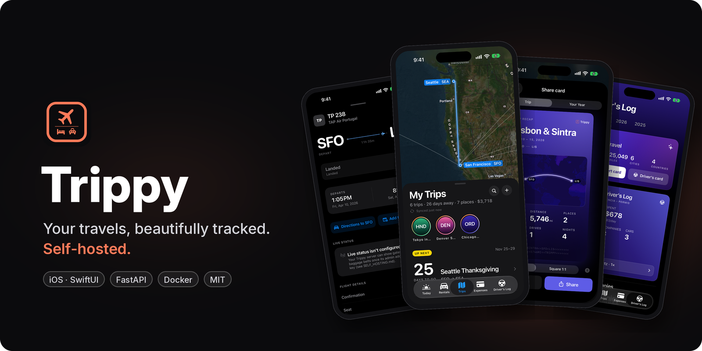

</div>

<br>

<p align="center">
  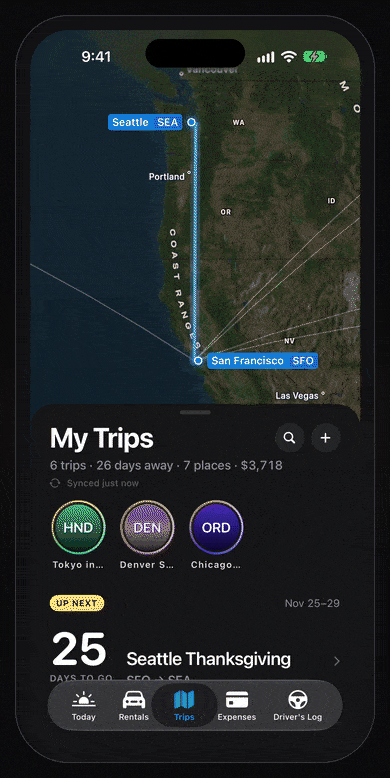
  <br>
  <sub>All screenshots use made-up demo data.</sub>
</p>

## Features

<table>
<tr>
<td width="50%" valign="top">✈️ <b>Flights</b><br>Times, seats and route on a map, in a day-by-day itinerary.</td>
<td width="50%" valign="top">🏨 <b>Stays</b><br>Hotels and rentals with check-in, check-out, nights and cost.</td>
</tr>
<tr>
<td valign="top">🚗 <b>Rental cars</b><br>Pickup, return, mileage and cost, collected in a Driver's Log.</td>
<td valign="top">🗺️ <b>Journeys</b><br>Link several trips (Lisbon → Madrid) into one route and map.</td>
</tr>
<tr>
<td valign="top">💸 <b>Split expenses</b><br>Add travelers, split equally, by amount, percentage or shares, and settle up.</td>
<td valign="top">📖 <b>Stories and share cards</b><br>Trip stories, a year-in-travel recap and cards you can save as images.</td>
</tr>
<tr>
<td valign="top">🔎 <b>Offline and search</b><br>Cached trips work without a connection; search across trips, flights and stays.</td>
<td valign="top">📬 <b>Email-in</b> <sub>(optional)</sub><br>Forward booking confirmations and Trippy files them. Plus .ics, CSV, .pkpass and .eml import.</td>
</tr>
<tr>
<td valign="top">📡 <b>Live status</b> <sub>(optional)</sub><br>Bring your own AeroDataBox, Aviationstack or FlightAware AeroAPI key.</td>
<td valign="top">🏠 <b>Self-host</b><br>One <code>docker compose up</code>. Your data stays on your server; deleted trips are kept 30 days.</td>
</tr>
</table>

<details>
<summary><b>More screenshots</b></summary>
<br>

<table>
<tr>
<td align="center">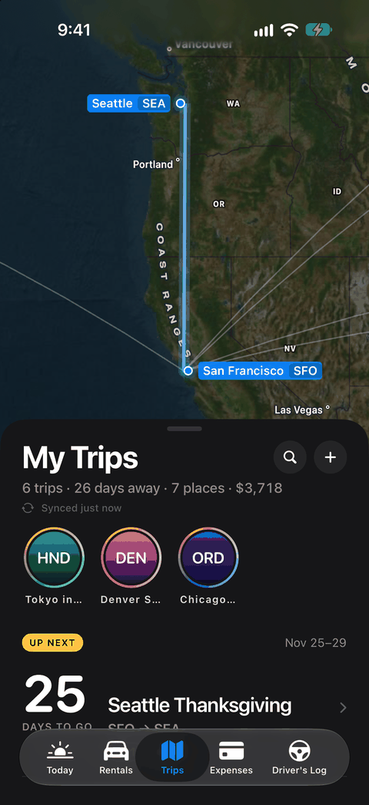<br><sub>Trips</sub></td>
<td align="center">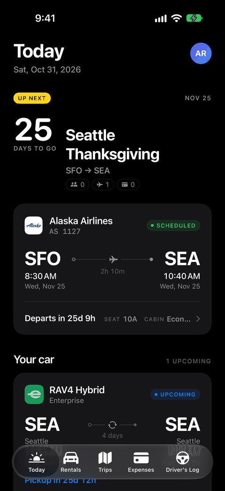<br><sub>Today</sub></td>
<td align="center">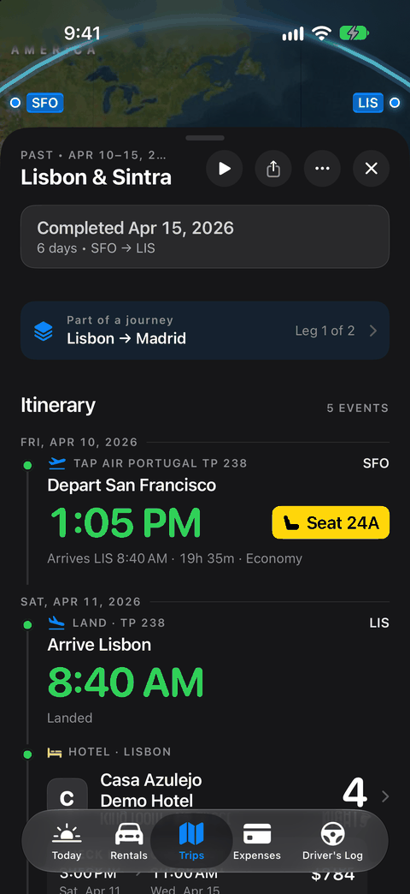<br><sub>Trip itinerary</sub></td>
</tr>
<tr>
<td align="center">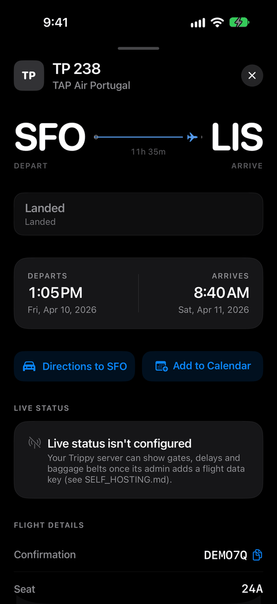<br><sub>Flight</sub></td>
<td align="center">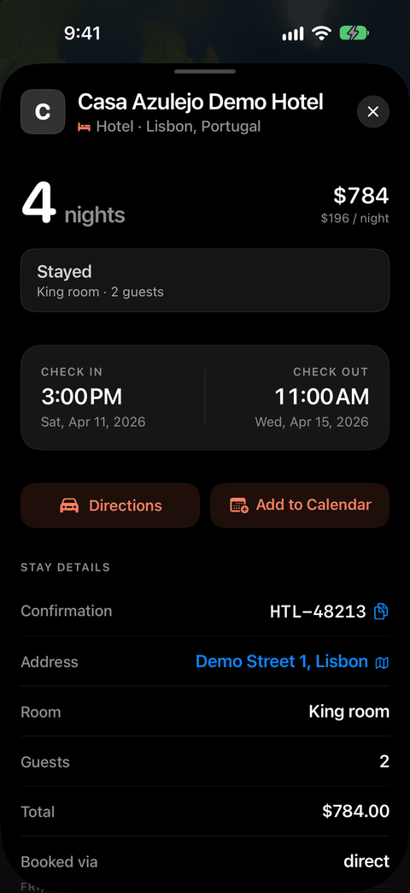<br><sub>Stay</sub></td>
<td align="center">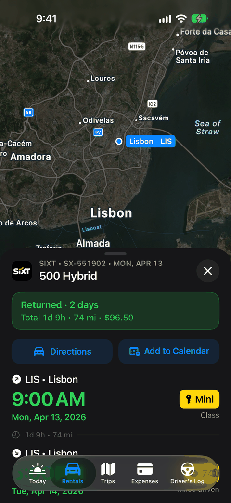<br><sub>Rental car</sub></td>
</tr>
<tr>
<td align="center">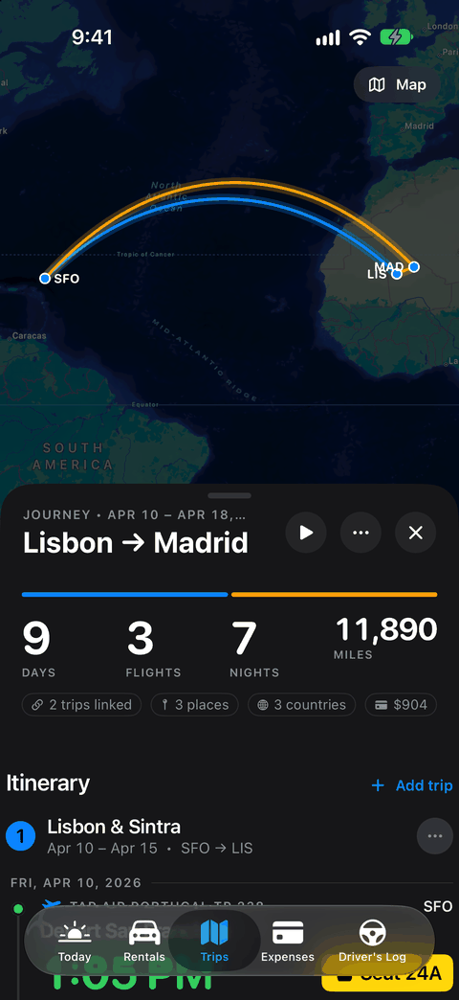<br><sub>Journey map</sub></td>
<td align="center">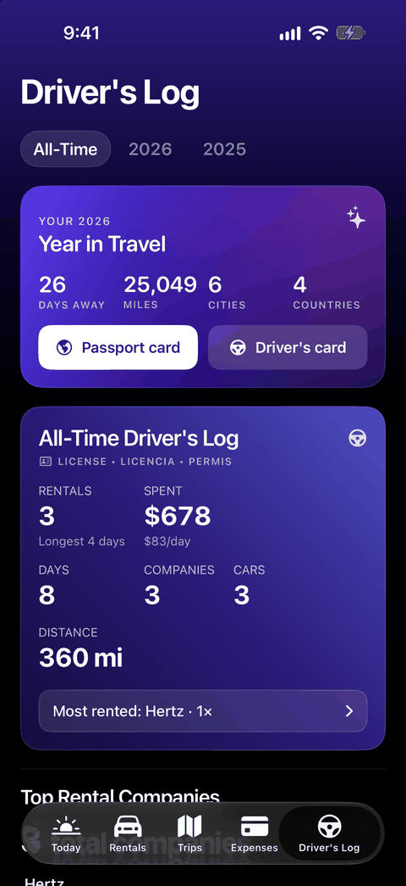<br><sub>Stats</sub></td>
<td align="center">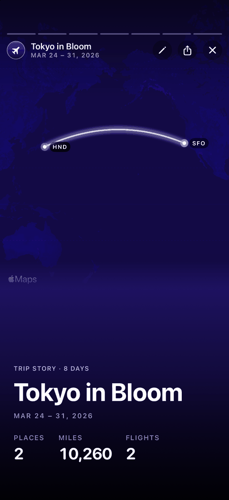<br><sub>Trip story</sub></td>
</tr>
<tr>
<td align="center">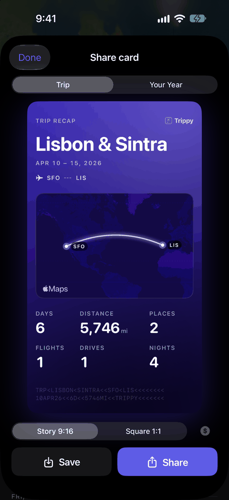<br><sub>Share card</sub></td>
<td align="center">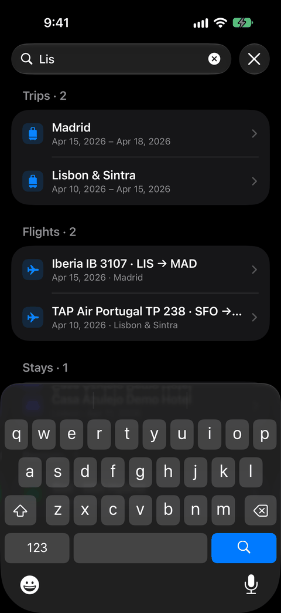<br><sub>Search</sub></td>
<td align="center">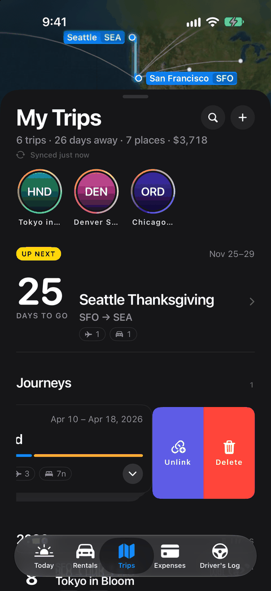<br><sub>Swipe actions</sub></td>
</tr>
<tr>
<td align="center">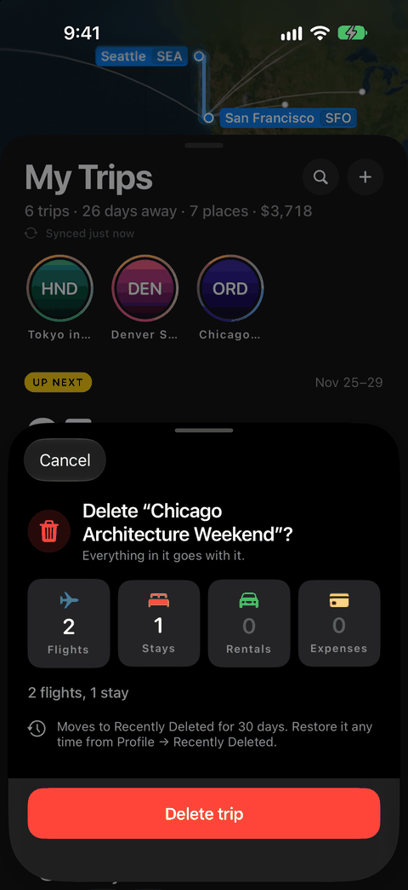<br><sub>Delete (30-day undo)</sub></td>
<td></td>
<td></td>
</tr>
</table>

</details>

## Quickstart

You need Docker with Compose v2.

```sh
git clone https://github.com/sakethramanujam/trippy.git
cd trippy
./install.sh                       # localhost only, open sign-up
curl http://127.0.0.1:8000/health
```

`install.sh` creates `.env` from [.env.example](.env.example) with a random signing key, then runs
`docker compose up -d --build`. Re-run it to upgrade; your `.env` and data are kept.

## Self-hosting

To reach the server from your phone (LAN, Tailscale, Caddy or Cloudflare Tunnel), set up email-in,
connect live flight status, or back up and upgrade, see **[SELF_HOSTING.md](SELF_HOSTING.md)**.
Importers are documented in [IMPORTERS.md](IMPORTERS.md).

## Build the iOS app

Requires a recent Xcode, iOS 17 or later, and [XcodeGen](https://github.com/yonaskolb/XcodeGen).

```sh
brew install xcodegen
cp ios-xcode/Local.xcconfig.example ios-xcode/Local.xcconfig   # optional, gitignored
xcodegen generate
open Trippy.xcodeproj
```

`ios-xcode/Local.xcconfig` holds your own settings:

| Setting | Meaning |
|---|---|
| `DEVELOPMENT_TEAM` | Your Apple team ID (or pick a team in Xcode > Signing & Capabilities). |
| `TRIPPY_API_BASE_URL` | The server a build points at by default. Empty means `http://localhost:8000`, which matches the Simulator next to `docker compose up`. |

The server can be changed in the app at any time (sign-in screen > Server, or Profile > Server).
Bundle identifiers live in `project.yml`; change them if you sign with your own team.
Details: [docs/IOS_API_CONFIG.md](docs/IOS_API_CONFIG.md).

## Development

```sh
python3 -m venv venv
venv/bin/pip install -r requirements.txt -r requirements-dev.txt
venv/bin/python -m pytest -q
TRIPPY_DEV_MODE=1 venv/bin/uvicorn app.main:app --reload
```

<details>
<summary>Repository layout</summary>

| Path | What it is |
|------|------------|
| `app/` | FastAPI server (Python): API, auth, importers, email-in, flight status |
| `alembic/` | Database migrations ([docs/MIGRATIONS.md](docs/MIGRATIONS.md)) |
| `tests/` | Server test suite (pytest) |
| `Dockerfile`, `docker-compose*.yml`, `install.sh` | Self-hosted deployment |
| `Trippy.swiftpm/` | iOS app sources (SwiftUI), also openable in Swift Playgrounds |
| `ios-xcode/`, `project.yml` | Xcode project spec (XcodeGen), Info.plist, widgets, build settings |
| `scripts/` | Optional one-off import and maintenance scripts |
| `docs/` | Design notes, API config, accounts, README images |

</details>

## Security

Trippy is meant to run on your own machine or private network. Keep `.env` private, use HTTPS
for anything reachable from the internet, and see
[Reaching it from your phone](SELF_HOSTING.md#reaching-it-from-your-phone).
Please report vulnerabilities privately instead of in a public issue.

## License

[MIT](LICENSE) © 2026 Saketha Ramanjam

Airline, hotel and rental brand logos in the app are trademarks of their owners and are used only to
identify them. See [LOGOS_SOURCES.md](LOGOS_SOURCES.md).
