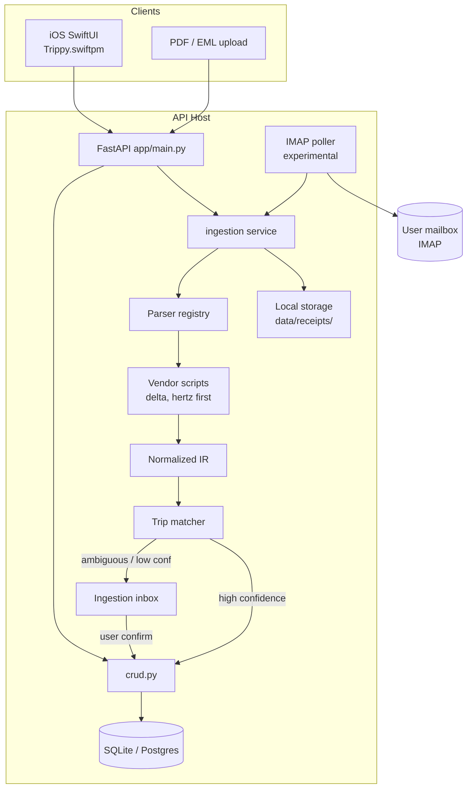
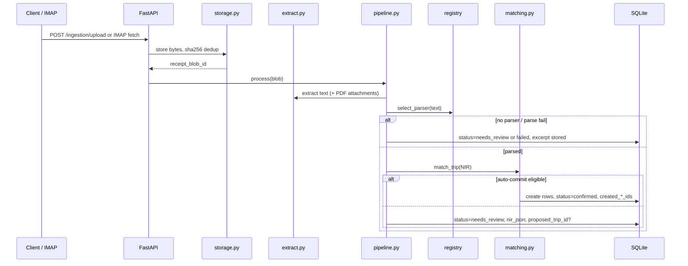

# Trippy: Flight & Rental Passport Stats + Script-Based Receipt Ingestion

| Field | Value |
|-------|-------|
| **Author** | Trippy maintainers |
| **Date** | 2026-10-01 |
| **Status** | Ready for Implementation |
| **Related** | `CORE_PRINCIPLES.md`, `app/models.py`, `app/crud.py`, `Trippy.swiftpm/Sources/Trippy/StatsView.swift` |

---

## Overview

Trippy already tracks trips, flights, rental cars, expenses, and a basic Passport/logbook UI (`GET /stats/` → `StatsView`). The data models are too thin for Flighty-like stats (no flight distance/duration/cost/confirmation IDs; rental cars lack cost, vehicle class, and confirmation numbers), and there is **no ingestion path**—bookings must be entered manually.

This design proposes three coordinated workstreams for the next phase:

1. **Enrich** `Flight`, `RentalCar`, and `Trip` (date bounds) so flights and rentals are first-class peers for passport stats.
2. **Expand** the stats API and iOS Passport UX with year filters, distance/duration/mileage aggregates, and peer flight/rental logbook sections.
3. **Add** a self-hosted, **script-based** ingestion pipeline. **Milestone A** is PDF/EML upload → inbox → typed confirm (no vendor parsers required). **Milestone B** adds the parser registry and one flight + one rental vendor. **Milestone C** (experimental) adds IMAP sync.

Parsing is **deterministic scripts per vendor**—not LLM-first—aligned with self-hosting and maintainability in `CORE_PRINCIPLES.md`.

### Acceptance criteria (v1 milestones)

1. After enrichment + stats PRs: manually created flights with `distance_miles` / rentals with `mileage_driven` appear correctly in Passport hero metrics and year filter.
2. Upload a PDF or EML → `ingestion_item` in inbox → confirm with typed NIR edits → `Flight`/`RentalCar` (+ optional `Expense`) rows exist on the chosen trip; duplicate sha256 upload is a no-op.
3. Delta email fixture and Hertz PDF fixture each parse to NIR with `confidence >= 0.85` in pytest; merge of a vendor PR requires golden NIR assertions.
4. Confirm path works with **hand-built NIR** before any vendor parser ships (inbox UX not blocked on DOM stability).
5. IMAP (when enabled): allowlisted mail only; cursor persisted; poller single-flight; `/ingestion/mailbox/settings` reports `last_sync_at` / last error; crash of one message does not abort the sync loop.

---

## Background & Motivation

### Current state

| Area | Reality today |
|------|----------------|
| Backend | FastAPI + SQLAlchemy + SQLite (`app/database.py` → `sqlite:///./trippy.db`). Schema created via `models.Base.metadata.create_all` in `app/main.py`. Alembic is listed in `requirements.txt` but **not initialized** (no `alembic.ini` / `versions/`). |
| Models | `Flight` has airline, airports, times, aircraft fields, delay, status. **Missing:** distance, duration, cost, confirmation, seat/class. `RentalCar` has company, model, pickup/dropoff, `mileage_driven`. **Missing:** cost, confirmation, vehicle class, fuel type, currency. `Trip` has no `start_date`/`end_date`. |
| Stats | `crud.get_trip_stats` returns **global** totals (all rows, no user filter) + top aircraft/airlines/cars/rental companies. No year filter, no miles/hours, no rental mileage sum. |
| Timeline | `crud.get_trip_timeline` merges flights, expenses, activities, rental_cars chronologically. |
| iOS Passport | `StatsView` (“Passport”) shows StatBoxes + `LogbookSection`. DTO drift in `NetworkManager.swift`: `ApiRentalCar.company` vs `rental_company`; `ApiActivity.name` vs `title`; `ApiDocument.name`/`file_url` vs `title`/`url`; thin `ApiFlight` (no times/aircraft). |
| Auth / tenancy | Open API: `CORS allow_origins=["*"]`, stub hashing `password + "notreallyhashed"`. Seed users `tester` (id=1) and `sarah`. |
| Ingestion | None. Seed data in `main.py` `seed_data()` only. `Expense.native_receipt_link` and `Document.url` are link-only; no local PDF blob store. |

### Pain points

- Manual entry does not scale for a Flighty-like product.
- Stats cannot show “miles flown,” “hours in air,” or “miles driven” without schema + aggregation work.
- Flights and rentals are peers in the product vision but rentals are underrepresented in Passport hero metrics (only appear in top lists).
- Self-hosted users need email/PDF ingest that runs on the API host without mandatory cloud LLMs.

---

## Goals & Non-Goals

### Goals (v1)

1. Enrich `Flight`, `RentalCar`, and `Trip` with fields needed for passport stats and trip matching (see Data Model).
2. Extend `GET /stats/` (and iOS Passport) so flights and rentals are first-class peers: aggregates + year filter + logbook sections.
3. Ship ingestion Milestone A (upload + inbox + confirm), then B (registry + one airline + one rental parser), then C (experimental IMAP).
4. Initialize Alembic and migrate existing SQLite without destroying seed/user data.
5. Keep parsers deterministic and runnable on the API host; optional OCR only as a later escape hatch.

### Non-Goals (v1)

- Real-time flight tracking / ADS-B / Flighty live status sync.
- LLM-first or cloud document AI as the primary parser.
- Hotels, trains, or generic “reservations” beyond flights + rental cars.
- **End-to-end encryption of receipt blobs** — deferred until real auth exists (see Key Decision on principles exception). Server-side filesystem storage is an explicit, temporary exception to the native-media-only principle for **operational booking documents** (PDF/EML), not for photo albums.
- Multi-tenant SaaS / real ACL; v1 is **single-tenant** (see Key Decision on `TRIPPY_DEFAULT_USER_ID`).
- Interactive flight map (UI placeholder in `StatsView` stays placeholder).
- Android / web clients.
- Production-hardened IMAP for unrestricted INBOX sync (IMAP is experimental; upload is the supported path).

---

## Proposed Design

### High-level architecture



### Single-tenant user identity (v1)

Until real auth ships, the API remains open. Ingestion and stats **do not pretend to be ACL-safe**.

| Mechanism | Behavior |
|-----------|----------|
| `TRIPPY_DEFAULT_USER_ID` | Env var, default `1` (seed `tester`). All `receipt_blobs.user_id`, `ingestion_items.user_id`, IMAP sync ownership, and trip-match candidate sets use this ID. |
| Stats | `get_trip_stats` remains **global across all DB rows** in v1 (matches today). Do **not** add a cosmetic `?user_id=` query param that looks like ACL. Document multi-user seed (`tester`/`sarah`) ⇒ Passport totals mix everyone. |
| Optional header | Clients may send `X-User-Id` for future-proofing; **ignored for authorization** in v1. If set and `TRIPPY_ALLOW_X_USER_ID=1`, it may override default for ingest attribution only—still not security. |

### Component layout (new packages)

```
app/
  ingestion/
    __init__.py
    models.py          # IngestionItem, ReceiptBlob, ImapSyncState
    schemas.py         # NIR + inbox API schemas
    pipeline.py        # store → extract → detect → parse → match → persist/queue
    extract.py         # MIME / PDF text extraction
    storage.py         # data/receipts/
    email_imap.py      # experimental IMAP poller
    matching.py
    registry.py
    parsers/
      __init__.py
      base.py
      airlines/
        delta_email.py   # first flight vendor
      rentals/
        hertz_pdf.py     # first rental vendor
        hertz_email.py   # may ship with Hertz or follow-up
  alembic/
```

---

### 1. Data model enrichment

#### Trip — v1 additions

| Field | Type | Notes |
|-------|------|--------|
| `start_date` | `DateTime`, nullable | Explicit trip window for matching & UI |
| `end_date` | `DateTime`, nullable | |

On create/update of child events, optionally **suggest** backfill if trip dates are null (earliest departure/pickup → `start_date`, latest arrival/dropoff → `end_date`)—never overwrite user-set bounds.

#### Flight — v1 fields

| Field | Type | Notes |
|-------|------|--------|
| `confirmation_number` | `String`, nullable, indexed | PNR / record locator |
| `distance_miles` | `Float`, nullable | **Canonical** stored distance (statute miles) |
| `duration_minutes` | `Integer`, nullable | Prefer explicit; else derive from timestamps |
| `cost` | `Float`, nullable | Ticket price from receipt |
| `currency` | `String(3)`, default `"USD"` | |
| `seat` | `String`, nullable | e.g. `14A` |
| `cabin_class` | `String`, nullable | `economy` / `premium_economy` / `business` / `first` |
| `booking_source` | `String`, nullable | `manual` / `ingestion` / `api` |

**Do not store `distance_km`.** Serializers and stats derive `distance_km = distance_miles * 1.609344` when exposing dual units.

**Later (not v1):** gate, terminal, CO₂, N-number, codeshare, fare basis, live delay feed, FK back to ingestion item.

#### RentalCar — v1 fields

| Field | Type | Notes |
|-------|------|--------|
| `confirmation_number` | `String`, nullable, indexed | |
| `cost` | `Float`, nullable | |
| `currency` | `String(3)`, default `"USD"` | |
| `vehicle_class` | `String`, nullable | `compact`, `suv`, `full_size`, … |
| `fuel_type` | `String`, nullable | optional in UI |
| `pickup_odometer` / `dropoff_odometer` | `Float`, nullable | When set: `mileage_driven = dropoff - pickup` |
| `booking_source` | `String`, nullable | |

Keep existing `mileage_driven`.

#### Expense — v1 addition

| Field | Type | Notes |
|-------|------|--------|
| `currency` | `String(3)`, default `"USD"` | Aligns with Flight/RentalCar; used when confirm applies `ExpenseHint` |

`ExpenseHint.currency` maps to `Expense.currency` on confirm (default `"USD"` if omitted).

#### New tables (ingestion) — FK direction

**Single direction of provenance (v1):** inbox item points at created domain rows. Domain rows do **not** FK back to `ingestion_items` (avoids circular SQLite FKs and ambiguous delete order).

**`receipt_blobs`**

| Column | Purpose |
|--------|---------|
| `id`, `user_id` | `user_id = TRIPPY_DEFAULT_USER_ID` |
| `storage_path` | Under `data/receipts/` |
| `content_type` | `application/pdf`, `message/rfc822`, … |
| `sha256` | Content hash; unique among **active** rows only (see soft-delete rules) |
| `original_filename` | |
| `created_at` | |
| `deleted_at` | Soft-delete marker; null = active |

**`ingestion_items`**

| Column | Purpose |
|--------|---------|
| `id`, `user_id` | |
| `receipt_blob_id` | FK → `receipt_blobs`, `ON DELETE SET NULL` |
| `source` | `pdf_upload` / `email_imap` / `manual_nir` |
| `vendor` | Detected key or null |
| `status` | `pending` / `parsed` / `needs_review` / `confirmed` / `rejected` / `failed` |
| `confidence` | `Float` 0–1 |
| `nir_json` | Full `ParseResult` JSON |
| `extracted_text_excerpt` | First ~2KB for inbox debugging (redact digits beyond confirmation patterns in logs, not necessarily in DB) |
| `error_message` | |
| `proposed_trip_id` | Nullable |
| `created_flight_ids` | JSON list of ints (multi-booking) |
| `created_rental_car_ids` | JSON list of ints |
| `created_expense_ids` | JSON list of ints |
| `email_message_id` | IMAP Message-ID dedup |
| `created_at`, `updated_at` | |

Using JSON ID lists avoids multi-row circular FKs while supporting N bookings per item. Confirm transaction: insert domain rows → update item status + ID lists in one DB commit. On **reject**: set status only (no domain rows exist yet). On **blob soft-delete**: set `receipt_blob_id` NULL via SET NULL if hard-deleting blob row; prefer soft-delete.

**`imap_sync_state`** (one row per configured mailbox)

| Column | Purpose |
|--------|---------|
| `id` | |
| `folder` | e.g. `INBOX` |
| `uidvalidity` | IMAP UIDVALIDITY |
| `last_uid` | Last successfully processed UID |
| `last_sync_at` | |
| `last_error` | |
| `updated_at` | |

Flights/rentals remain trip-scoped. **No domain rows until trip is resolved** (auto or user confirm).

---

### 2. Normalized Intermediate Representation (NIR)

```python
class ExpenseHint(BaseModel):
    """Optional expense to create alongside the booking on confirm."""
    amount: float
    description: str
    currency: str = "USD"
    date: Optional[datetime] = None
    # payer_id defaults to TRIPPY_DEFAULT_USER_ID at confirm time

class NormalizedBooking(BaseModel):
    booking_type: Literal["flight", "rental_car"]
    vendor: str
    confirmation_number: Optional[str] = None
    cost: Optional[float] = None
    currency: str = "USD"
    confidence: float
    raw_excerpt: Optional[str] = None

class NormalizedFlight(NormalizedBooking):
    booking_type: Literal["flight"] = "flight"
    airline: str
    flight_number: str
    departure_airport: str
    arrival_airport: str
    departure_time: datetime
    arrival_time: datetime
    aircraft_model: Optional[str] = None
    distance_miles: Optional[float] = None
    duration_minutes: Optional[int] = None
    seat: Optional[str] = None
    cabin_class: Optional[str] = None

class NormalizedRental(NormalizedBooking):
    booking_type: Literal["rental_car"] = "rental_car"
    rental_company: str
    car_model: Optional[str] = None
    vehicle_class: Optional[str] = None
    fuel_type: Optional[str] = None
    pickup_location: str
    dropoff_location: str
    pickup_time: datetime
    dropoff_time: datetime
    mileage_driven: Optional[float] = None

class ParseResult(BaseModel):
    success: bool
    vendor: Optional[str] = None
    bookings: List[NormalizedFlight | NormalizedRental] = []
    expense_hint: Optional[ExpenseHint] = None
    confidence: float = 0.0
    errors: List[str] = []
```

#### Confidence rubric (parsers + pipeline)

| Condition | Score effect |
|-----------|----------------|
| `can_parse` vendor fingerprint match (From domain / subject / logo URL / PDF title) | base select score 0.5–1.0 |
| Required identity fields present (flight: airline, number, both airports, both times; rental: company, both locations, both times) | set parse confidence floor **0.6** |
| All times parse successfully and are normalized to **naive UTC** | **+0.2** |
| `confirmation_number` present and matches vendor pattern | **+0.2** |
| Optional enrichment (aircraft, seat, distance, cost) each | **+0.0** (nice-to-have; do not inflate auto-commit) |
| Missing any required field after parse | cap confidence at **0.4** → `needs_review` or `failed` if nothing usable |

**Thresholds:**

- Registry: pick highest `can_parse`; require `>= 0.5`, else no parser → `needs_review` with excerpt only.
- Auto-commit domain rows: `min(parse.confidence, match_score) >= 0.85` and unique trip; else inbox.
- Expected v1 auto-commit rate: **low** except confirmation_number updates and single-trip accounts (see matching).

---

### 3. Text extraction pipeline

Module: `app/ingestion/extract.py`.

| Input | Behavior |
|-------|----------|
| `message/rfc822` / `.eml` | Parse with stdlib `email`. Body: prefer **`text/html`** part, else `text/plain`. Also collect `application/pdf` attachments and run each through the PDF path (separate child pipeline jobs or sequential parses merged into one `ParseResult.bookings`). |
| `application/pdf` | **`pypdf`** `PdfReader` → `extract_text()` per page, join with newlines. **Max 15 MB**, **max 30 pages**; over limit → `failed` with clear error. |
| `text/html` upload | BeautifulSoup `get_text` + keep raw HTML string for selectors. |
| Charset | Prefer declared charset; fallback `utf-8` then `latin-1`. |

**PDF library decision:** use **`pypdf`** for v1 (simpler API, adequate for confirmation PDFs). If Hertz (or similar) layout extraction is empty/garbled, revisit **`pdfminer.six`** as an escape hatch behind a per-parser flag—do not dual-depend by default.

---

### 4. Parser registry + worked examples

```python
class ParserProtocol(Protocol):
    vendor: str
    booking_types: Sequence[str]
    def can_parse(self, *, text: str, content_type: str, filename: str | None) -> float: ...
    def parse(self, *, text: str, content_type: str, raw_bytes: bytes) -> ParseResult: ...
```

#### Worked example: Delta confirmation email (`delta_email`)

```python
# can_parse
# - From contains "@delta.com" or "Delta Air Lines" in Subject → 0.9
# - Body contains "Confirmation Number" / "eTicket Receipt" → 0.7+

# parse (HTML via BeautifulSoup) — illustrative selectors/regex:
# confirmation: regex r"Confirmation(?:\s+Number)?\s*[:\s]*([A-Z0-9]{6})"
# flight row: look for patterns like "DL\s*1234" near airport codes
# airports: r"\b([A-Z]{3})\b" adjacent to "Depart" / "Arrive" labels
# times: parse "Jan 15, 2026 10:15 AM" with dateutil.parser, then force_naive_utc()
# airline: "Delta Air Lines"
#
# confidence: apply rubric (required fields + times + PNR → typically 0.6+0.2+0.2=1.0)
# expense_hint: if "Total.*" money amount found →
#   ExpenseHint(amount=..., currency="USD", description="Delta {flight_number}")
```

**Datetime convention (v1):** All NIR timestamps and DB writes use **naive UTC** (no `tzinfo`), matching existing seed/`datetime.utcnow()` usage in `app/main.py`. After `dateutil` parse, if aware → convert to UTC and `replace(tzinfo=None)`; if naive → assume already UTC. Matching window comparisons must not mix aware and naive.

#### Worked example: Hertz receipt PDF (`hertz_pdf`)

```python
# can_parse
# - filename/text contains "Hertz" or "hertz.com" → 0.8+
# - ACRISS or "Rental Agreement" + "Vehicle" → 0.6+

# parse on pypdf text:
# confirmation: r"(?:Confirmation|Res(?:ervation)?)\s*(?:#|Number)[:\s]*([A-Z0-9-]+)"
# pickup/dropoff locations: lines after "Pick-Up" / "Return"
# times: paired date/time lines
# car_model: after "Vehicle Class" or "Mazda|Tesla|Toyota..."
# vehicle_class: map "F"/"B" ACRISS first letter or words like "SUV"
# cost: r"Estimated Total\s*\$?\s*([0-9,]+\.\d{2})"
# rental_company: "Hertz"
```

Fixtures: `app/ingestion/parsers/fixtures/delta/confirmation_sample.eml` + `expected.json`; `fixtures/hertz/receipt_sample.pdf` + `expected.json`.

**v1 vendors in order:** (1) `delta_email`, (2) `hertz_pdf`. **Follow-up PR:** `united_email`, `enterprise_email`, `hertz_email`.

---

### 5. Ingestion pipeline flow



**Manual NIR path:** `POST /ingestion/manual` accepts a `ParseResult` body, stores an `ingestion_item` with `source=manual_nir`, and **always** creates status `needs_review` (never auto-commit)—including after parsers ship. Use this for tests, hand-built NIR, and proving confirm before vendors exist.

#### Trip matching heuristics (`matching.py`)

Candidate trips: all trips where `owner_id == TRIPPY_DEFAULT_USER_ID` OR user is a participant (still single-tenant attribution).

| Signal | Weight |
|--------|--------|
| Booking datetime within `[trip.start_date − 1d, trip.end_date + 1d]` when both dates set | **+0.45** |
| Else: booking datetime within `[min(child events) − 1d, max(child events) + 1d]` | **+0.35** |
| Airport / city token overlap with title/description / existing flight airports | **+0.25** |
| Same `confirmation_number` (+ vendor / flight_number or pickup_time) on trip | **Update path** (skip create); treat as match score 1.0 |
| Exactly one trip whose window (dates or events) contains “now” or is upcoming (`end_date >= utcnow()` or latest event ≥ utcnow() − 7d), and total trips ≤ 2 | **+0.15** |

**Active/upcoming definition:** `end_date >= utcnow()` if set; else any flight `arrival_time >= utcnow() - 7d` or rental `dropoff_time >= utcnow() - 7d`; else trip with null dates and no events counts as weak candidate only if it is the sole trip.

**Auto-commit:** `min(parser.confidence, match_score) >= 0.85` and exactly one top trip. **v1 expectation:** most items go to inbox; auto-commit mainly for confirmation updates and single-trip databases. Auto-commit uses the same trip eligibility rule as confirm (below).

#### Confirm API (typed edits)

```python
class IngestionConfirmRequest(BaseModel):
    trip_id: int
    # Full replacement list for bookings to persist. If omitted, use nir_json.bookings as-is.
    bookings: Optional[List[NormalizedFlight | NormalizedRental]] = None
    # If NIR has N bookings, client may send a subset (only those are created).
    # Indices refer to the original nir_json.bookings order when using include_indices.
    include_indices: Optional[List[int]] = None
    expense_hint: Optional[ExpenseHint] = None  # override or clear with explicit null handling
    apply_expense_hint: bool = True

class IngestionConfirmResponse(BaseModel):
    ingestion_item_id: int
    status: Literal["confirmed"]
    flight_ids: List[int] = []
    rental_car_ids: List[int] = []
    expense_ids: List[int] = []
```

Validation: Pydantic-parse bookings before CRUD. If both `bookings` and `include_indices` are set, `bookings` wins as the explicit payload. Empty selection → 400.

**Trip authorization (confirm + auto-commit):** Resolve `trip_id` and require `trip.owner_id == TRIPPY_DEFAULT_USER_ID` **or** `TRIPPY_DEFAULT_USER_ID` ∈ `trip.participants`. Otherwise return **404** (do not leak existence of other users’ trips). Mirrors the matching candidate set so clients cannot attach bookings to arbitrary seed trips (e.g. a trip only Sarah owns).

---

### 6. Email ingestion (experimental; upload is the supported path)

**Milestone C.** Ship upload-only first; treat IMAP as explicitly experimental in docs and flags (`TRIPPY_IMAP_ENABLED=0` default).

| Topic | Spec |
|-------|------|
| Cursor | Persist `uidvalidity` + `last_uid` in `imap_sync_state`. If UIDVALIDITY changes, reset `last_uid` to 0 and log warning. |
| Dedup | Also by `email_message_id` on `ingestion_items`. |
| Concurrency | **Single poller**: file lock `data/imap.poll.lock` or document **uvicorn workers=1** when IMAP enabled. No duplicate interval threads per worker. |
| Settings precedence | **Env wins** over DB for host/user/password/folder. `PUT /ingestion/mailbox/settings` may store non-secret prefs (folder, allowlist, enabled). Passwords: env `TRIPPY_IMAP_PASSWORD` preferred; if stored in DB, must be local-only warning—v1 recommend env-only secrets. `GET` never returns password. |
| Allowlist | **Required for v1**: `TRIPPY_IMAP_FROM_ALLOWLIST` (comma domains, e.g. `delta.com,hertz.com,united.com`). Messages not matching From-domain are skipped (not failed). Empty allowlist ⇒ IMAP sync refuses to run. |
| Attachments | PDF attachments processed via same extract/pipeline as uploads; HTML/text body also parsed. |
| Providers | Document Fastmail app password; Gmail: app password **may stop working** as Google pushes OAuth—call out risk; OAuth IMAP out of scope for v1. |
| Flood control | Max messages per sync (e.g. 50); process newest-first after cursor. |

**Secondary (supported):** `POST /ingestion/upload` for PDF/EML from iOS share sheet or curl.

---

### 7. Stats API + Passport UX

#### Exact `StatsResponse` (backward compatible)

Flat keys **keep today’s names** so existing `ApiStats` continues to decode. Nested objects add peer structure; nested top-list keys **alias the same names** where they overlap.

```python
class StatItem(BaseModel):
    name: str
    count: int

class FlightStatsBlock(BaseModel):
    count: int
    airports: int
    distance_miles: float
    distance_km: float  # derived: miles * 1.609344
    duration_minutes: int
    total_cost_by_currency: dict[str, float]  # e.g. {"USD": 3200.0}
    top_aircraft: list[StatItem]
    top_airlines: list[StatItem]

class RentalStatsBlock(BaseModel):
    count: int
    mileage_driven: float
    duration_days: float
    total_cost_by_currency: dict[str, float]
    top_cars: list[StatItem]
    top_rental_companies: list[StatItem]  # same name as flat key, not top_companies
    top_vehicle_classes: list[StatItem]

class StatsResponse(BaseModel):
    year: Optional[int] = None
    # --- nested (preferred) ---
    flights: FlightStatsBlock
    rentals: RentalStatsBlock
    total_trips: int
    total_expenses_by_currency: dict[str, float]  # e.g. {"USD": 1450.0, "EUR": 200.0}
    # --- deprecated flat aliases (identical names to today’s GET /stats/) ---
    total_expenses: float       # = total_expenses_by_currency.get("USD", 0.0) ONLY — not all currencies
    total_flights: int          # = flights.count
    total_airports: int         # = flights.airports
    top_aircraft: list[StatItem]
    top_airlines: list[StatItem]
    top_cars: list[StatItem]
    top_rental_companies: list[StatItem]
```

**Currency:** never sum across currencies into one float for any aggregate. Booking costs use `total_cost_by_currency`; expenses use `total_expenses_by_currency`. Flat `total_expenses` is retained for today’s `ApiStats` but is **USD-only** (`Expense.currency == "USD"`, treating null/missing as USD for pre-migration rows). Passport should prefer the by-currency maps; show USD hero when present.

Query: `GET /stats/?year=2026` using SQLite `strftime('%Y', ...)`. Year filter requires timestamps; rows with null times excluded from year-scoped aggregates.

`GET /stats/years` → sorted distinct years from flight departures and rental pickups.

#### iOS Passport

- Year picker; peer hero metrics (flights/miles vs rentals/miles driven).
- **PR 4 DTO audit** against `app/schemas.py`: fix `ApiRentalCar` (`rental_company` CodingKeys), `ApiActivity` (`title`), `ApiDocument` (`title`/`url`), expand `ApiFlight` (times, aircraft, new passport fields as optional). Soft `try?` defaults on trip decode remain for resilience but should not be required for correctly named keys.

---

### 8. Storage & privacy alignment

- Receipts on API host: `data/receipts/{user_id}/{yyyy}/{sha256}.{ext}`; `.gitignore` `data/`.
- **Principles exception (explicit):** photo albums stay native-link-only per `CORE_PRINCIPLES.md`; **operational booking PDFs/EML are server-stored** so parsers can run. E2E encryption remains a Non-Goal until auth.
- **Soft-delete vs dedup:**
  1. Active dedup key: unique on `(user_id, sha256)` **where `deleted_at IS NULL`** (partial unique index; on SQLite emulate with app-level check or `sha256` + `deleted_at` sentinel).
  2. `DELETE /ingestion/blobs/{id}` sets `deleted_at`, **unlinks the file from disk** (path must not be served afterward). Related inbox items keep history; `receipt_blob_id` may remain for audit metadata but reads of bytes return 410/404.
  3. Re-upload of the same bytes after soft-delete: **create a new blob row** (or clear `deleted_at` on the old row and rewrite bytes)—either is fine; prefer **undelete + rewrite** when an existing soft-deleted row matches sha256 to avoid orphan metadata growth. Active upload of an already-active sha256 remains a no-op (return existing blob id).
- Retention: `POST /ingestion/inbox/purge` hard-deletes `rejected`/`failed` items older than N days (default 30) and soft-deletes their blobs if unreferenced. Confirmed items keep blob by default for audit.

---

## API / Interface Changes

| Method | Path | Purpose |
|--------|------|---------|
| `GET` | `/stats/?year=` | Extended stats |
| `GET` | `/stats/years` | Distinct years |
| `POST` | `/ingestion/upload` | Multipart PDF/EML |
| `POST` | `/ingestion/manual` | Post `ParseResult`; always `needs_review` (never auto-commit) |
| `GET` | `/ingestion/inbox` | List review items |
| `GET` | `/ingestion/inbox/{id}` | Detail + NIR |
| `POST` | `/ingestion/inbox/{id}/confirm` | Typed confirm body |
| `POST` | `/ingestion/inbox/{id}/reject` | Discard |
| `POST` | `/ingestion/inbox/purge` | Purge old rejected/failed |
| `DELETE` | `/ingestion/blobs/{id}` | Soft-delete receipt |
| `GET/PUT` | `/ingestion/mailbox/settings` | Non-secret prefs + status |
| `POST` | `/ingestion/mailbox/sync` | Trigger IMAP (experimental) |

Existing create endpoints accept new optional fields without breaking.

---

## Data Model Changes

### Migration strategy

1. Alembic baseline of current schema.
2. Rev: Trip `start_date`/`end_date` + Flight/RentalCar enrichment + `Expense.currency` (**no** `distance_km` column; **no** domain→ingestion FK).
3. Rev: `receipt_blobs`, `ingestion_items`, `imap_sync_state` (partial/active sha256 uniqueness among non-deleted blobs).
4. Prefer `alembic upgrade head` in docs; backup `trippy.db` first. SQLite batch mode if needed.


---

## Alternatives Considered

### A. LLM-first parsing — rejected for v1
Non-determinism, privacy, poor self-host fit.

### B. Gmail API only — rejected
Not self-hosted-first; IMAP covers more hosts (even if experimental).

### C. Always create “Unassigned” trip — rejected
Pollutes stats/trip list.

### D. Link-only PDF storage — rejected
Parsers need bytes on the API host.

### E. Dual FKs domain ↔ ingestion — rejected for v1
Circular SQLite complexity; single direction via `created_*_ids` on inbox items.

---

## Security & Privacy Considerations

| Risk | Severity | Mitigation |
|------|----------|------------|
| Receipts contain PNR / payment hints | High | Local disk; soft-delete/purge; avoid logging full bodies |
| IMAP credentials | High | Env-only secrets preferred; never echo on GET |
| Unauthenticated API + CORS `*` already | High (pre-existing) | Single-tenant honesty; **restrict CORS and add auth before enabling IMAP on a non-LAN host**; do not treat ingest as safe on the public internet |
| Path traversal | Medium | Resolve under `data/receipts` only |
| Malicious PDF | Medium | 15 MB / 30 page caps; no shell-outs |
| Fake `?user_id=` ACL theater | Medium | Not implemented; `TRIPPY_DEFAULT_USER_ID` only |

---

## Observability

- Logs: `ingestion_item_id`, `vendor`, `status`, `confidence`, `duration_ms` — not full email/PDF text.
- Counters: `ingestion_uploaded_total`, `ingestion_parsed_total{vendor,status}`, `imap_sync_errors`.
- When IMAP enabled: `GET /ingestion/mailbox/settings` (and `/health`) include `imap_last_sync_at`, `imap_last_error`, `uidvalidity`, `last_uid`.
- Debugging bad parsers: persist `nir_json` + `extracted_text_excerpt`; fixture capture = export excerpt redacting long digit runs except 6-char PNRs; do not auto-commit production MIME into git.
- Rollback IMAP: disable flag; orphaned `needs_review` rows purgeable via inbox purge.

---

## Testing

Repo currently has **no test suite**. Add with ingestion work:

| Layer | Requirement |
|-------|-------------|
| Parser unit tests | pytest; each vendor PR must include fixture + golden `expected.json` NIR; confidence assertions |
| Extraction | EML multipart preference (html > plain); PDF page limit behavior |
| API | Upload dedup (same sha256 → same blob); confirm creates rows; confirm subset indices; reject leaves no domain rows |
| Matching | Trip with `start_date`/`end_date`; confirmation_number update path |
| Migrations | `alembic upgrade head` / `downgrade -1` on a **copy** of `trippy.db` in CI or documented manual smoke |

---

## Rollout Plan

1. Flags: `TRIPPY_INGESTION_ENABLED=1`, `TRIPPY_IMAP_ENABLED=0`.
2. Schema + stats before parsers (Passport improves via manual entry).
3. Upload + manual NIR + confirm before first vendor.
4. First vendor pair (Delta + Hertz PDF); then more vendors.
5. IMAP experimental behind flag + allowlist + workers=1.
6. Restrict CORS / auth before non-LAN IMAP.
7. Rollback: flags off; DB backup restore for schema; purge inbox orphans.

---

## Open Questions

1. ~~Trip `start_date`/`end_date`?~~ **Resolved:** add nullable dates in enrichment PR; use in matching.
2. ~~PDF library?~~ **Resolved:** `pypdf` for v1; pdfminer escape hatch if needed.
3. ~~User-scoped stats when auth lands?~~ **Resolved:** v1 stays **global** stats + single-tenant ingest attribution (`TRIPPY_DEFAULT_USER_ID`). User-scoped stats are deferred until real auth; do not invent ACL query params now.
4. ~~Currency?~~ **Resolved:** `total_cost_by_currency` / `total_expenses_by_currency`; flat `total_expenses` is USD-only.
5. ~~iOS API base URL?~~ **Resolved:** **Build-time config only** (Info.plist / Xcode scheme environment). No runtime Settings UI. Default remains `http://127.0.0.1:8000` for Simulator; device/self-host builds override via scheme/`INFOPLIST` key (e.g. `TRIPPY_API_BASE_URL`). ATS exceptions stay a build/scheme concern.

### Implementation kickoff

**Start with PR 1–2** (Alembic baseline + enrich Trip/Flight/RentalCar/Expense). Do not begin ingestion or iOS Passport work until those land.

---

## Key Decisions

1. **Script-based vendor parsers with a registry, not LLM-first** — Deterministic, testable, self-hosted.
2. **Flights and rentals are peer domains in stats** — Nested `flights` / `rentals` plus deprecated flat aliases with **identical list key names** (`top_rental_companies`, etc.).
3. **Normalized IR between parsers and persistence** — Typed confirm edits use NIR models, not free `dict`.
4. **Review inbox instead of Unassigned trips** — No domain rows until trip resolved.
5. **Upload-first ingest; IMAP experimental** — Same pipeline; IMAP requires allowlist, cursor state, single poller; Gmail app-password risk documented.
6. **Server-side receipt store is an explicit principles exception** — Operational PDF/EML for parsing; native links remain for photos; E2E encryption deferred with auth (Non-Goals).
7. **Alembic for schema evolution** — Baseline then additive revisions.
8. **Auto-apply only at ≥0.85 with unique trip match; inbox-first otherwise** — Trip `start_date`/`end_date` added to make matching real; low expected auto-commit rate in multi-trip DBs.
9. **Enrichment fields nullable; canonical `distance_miles` only** — Derive km in API; safe SQLite migrate. Add `Expense.currency` alongside booking currencies.
10. **Full iOS DTO audit in Passport PR** — Fix rental/activity/document/flight field drift vs `app/schemas.py`.
11. **Single-tenant v1 via `TRIPPY_DEFAULT_USER_ID`** — No fake ACL query params; stats remain global until auth. Confirm/auto-commit enforce default user owns or participates in `trip_id`.
12. **Single-direction provenance** — `ingestion_items.created_*_ids` only; no domain→ingestion FK.
13. **Money aggregated per currency** — Flight/rental `total_cost_by_currency` and expense `total_expenses_by_currency`; never silent cross-currency sums. Deprecated flat `total_expenses` is **USD-only** for iOS `ApiStats` compat.
14. **`pypdf` for v1 PDF text extraction**.
15. **Naive UTC everywhere for v1 datetimes** — Strip tzinfo after parse; match existing SQLAlchemy/seed behavior.
16. **`POST /ingestion/manual` always `needs_review`** — Never auto-commit hand-built NIR.
17. **Soft-delete unlinks files; re-upload may undelete** — Active sha256 uniqueness excludes deleted rows.
18. **iOS API base URL is build-time only** — Info.plist / scheme env (e.g. `TRIPPY_API_BASE_URL`); no in-app Settings UI; Simulator default remains localhost.

---

## Risks

| Risk | Severity | Mitigation |
|------|----------|------------|
| Vendor HTML/PDF changes | High | Fixtures + CI; inbox fallback; split vendor PRs |
| IMAP flood / Gmail OAuth pressure | High | Allowlist required; experimental flag; upload-first |
| SQLite migration footguns | Medium | Additive columns; backup; avoid circular FKs |
| Global stats mix seed users | Medium | Documented; auth later |
| Cross-currency money mistakes | Medium | Per-currency maps for bookings + expenses; flat `total_expenses` is USD-only |
| Uvicorn multi-worker duplicate IMAP | Medium | Lock or workers=1 |
| Parser time on request thread | Medium | Size caps; IMAP in locked background |

---

## References

- `CORE_PRINCIPLES.md`
- `app/models.py`
- `app/crud.py` — `get_trip_stats`, `get_trip_timeline`, `create_trip_flight`, `create_trip_rental_car`
- `app/main.py` — CORS `*`, `seed_data`, `create_all`
- `app/schemas.py`
- `Trippy.swiftpm/Sources/Trippy/StatsView.swift`
- `Trippy.swiftpm/Sources/Trippy/NetworkManager.swift` — DTO drift

---

## PR Plan

### PR 1: Alembic baseline + project wiring

- **Title:** Initialize Alembic and document migration workflow
- **Files/components:** `alembic.ini`, `alembic/env.py`, baseline revision, README; clarify `create_all` vs upgrade
- **Dependencies:** None
- **Description:** Capture current schema as baseline.

### PR 2: Enrich Trip, Flight, and RentalCar

- **Title:** Add passport fields and trip date bounds
- **Files/components:** `app/models.py`, `app/schemas.py`, `app/crud.py`, Alembic rev, optional seed backfill
- **Dependencies:** PR 1
- **Description:** `Trip.start_date`/`end_date`; flight confirmation/distance_miles/duration/cost/currency/seat/cabin/booking_source; rental confirmation/cost/currency/vehicle_class/fuel/odometers/booking_source; `Expense.currency` (default USD) for `ExpenseHint` mapping. No `distance_km` column. No ingestion FKs.

### PR 3: Stats API — peer aggregates + year filter

- **Title:** Expand `/stats/` with nested flight & rental blocks
- **Files/components:** `crud.get_trip_stats`, `main.py`, `StatsResponse` schema, `/stats/years`
- **Dependencies:** PR 2
- **Description:** Implement exact `StatsResponse` (nested + flat aliases). `total_cost_by_currency` and `total_expenses_by_currency`; flat `total_expenses` = USD-only. No cosmetic user_id ACL param. Global scope documented.

### PR 4: iOS Passport UX + full DTO audit

- **Title:** Passport year filter, peer heroes, and Swift DTO sync
- **Files/components:** `StatsView.swift`, `NetworkManager.swift` (Flight/Rental/Activity/Document CodingKeys), mock JSON; Info.plist / scheme `TRIPPY_API_BASE_URL` (or equivalent) read in `NetworkManager`
- **Dependencies:** PR 3
- **Description:** Nested stats UI; fix `rental_company`, `title`/`url` activity/document drift; richer `ApiFlight`. Replace hardcoded `http://127.0.0.1:8000` with **build-time** base URL from Info.plist/scheme (Simulator default localhost). **No** in-app Settings UI for API URL.

### PR 5: Receipt storage + inbox API skeleton

- **Title:** Receipt blobs and ingestion inbox without parsers
- **Files/components:** `app/ingestion/storage.py`, models, upload endpoint, inbox list/get/reject, soft-delete/purge stubs, `.gitignore` `data/`
- **Dependencies:** PR 2
- **Description:** sha256 dedup; items land in `needs_review`/`pending` with excerpt optional.

### PR 6: Manual NIR + trip matching + typed confirm → CRUD

- **Title:** Confirm ingestion into Flight/Rental/Expense with matching
- **Files/components:** `POST /ingestion/manual`, `matching.py`, confirm route with `IngestionConfirmRequest`, `created_*_ids`, dedup-by-confirmation update
- **Dependencies:** PR 5
- **Description:** Prove upload/manual → inbox → confirm **before** any vendor parser. Auto-commit path implemented but rare.

### PR 7: Extraction pipeline + parser registry (no vendor scripts)

- **Title:** Text extraction and parser registry wiring
- **Files/components:** `extract.py`, `registry.py`, `parsers/base.py`, `pipeline.py`, deps (`pypdf`, `beautifulsoup4`, `lxml`, `python-multipart`, `python-dateutil`), pytest harness; shared `force_naive_utc()` helper
- **Dependencies:** PR 6
- **Description:** MIME/PDF extraction per spec; registry select; if no parser, `needs_review` with excerpt. Pipeline hooks into upload.

### PR 8: First vendors — Delta email + Hertz PDF

- **Title:** Add delta_email and hertz_pdf parsers with golden fixtures
- **Files/components:** `parsers/airlines/delta_email.py`, `parsers/rentals/hertz_pdf.py`, fixtures + expected NIR, pytest
- **Dependencies:** PR 7
- **Description:** Confidence rubric; merge gate = golden tests. One flight + one rental only.

### PR 9: Additional vendors — United + Enterprise (+ optional Hertz email)

- **Title:** Add united_email and enterprise_email parsers
- **Files/components:** new parser modules + fixtures
- **Dependencies:** PR 8
- **Description:** Same registry pattern; no pipeline core changes.

### PR 10: Experimental IMAP sync

- **Title:** IMAP poller with cursor, allowlist, and single-flight lock
- **Files/components:** `email_imap.py`, `imap_sync_state`, settings/sync endpoints, README (Gmail/Fastmail risks), health fields
- **Dependencies:** PR 8 (parsers useful) or PR 7 (excerpt-only still ok)
- **Description:** Env-over-DB secrets; required from-allowlist; UIDVALIDITY handling; `TRIPPY_IMAP_ENABLED=0` default; workers=1 or file lock.

### PR 11: iOS ingestion inbox + PDF upload

- **Title:** iOS review inbox and document upload
- **Files/components:** SwiftUI inbox/confirm/reject/upload; NetworkManager methods (same build-time base URL as PR 4)
- **Dependencies:** PR 6 (PR 8 optional for auto-parsed NIR); ideally PR 4 for shared API base URL plumbing
- **Description:** Upload PDFs; edit/confirm bookings onto a trip; refresh Passport. Uses build-time API base URL (Info.plist/scheme)—not runtime settings.

### PR 1 note (kickoff)

PR 1–2 are the agreed starting slice: Alembic baseline, then Trip dates + Flight/RentalCar/Expense enrichment.

---

*End of design document.*
